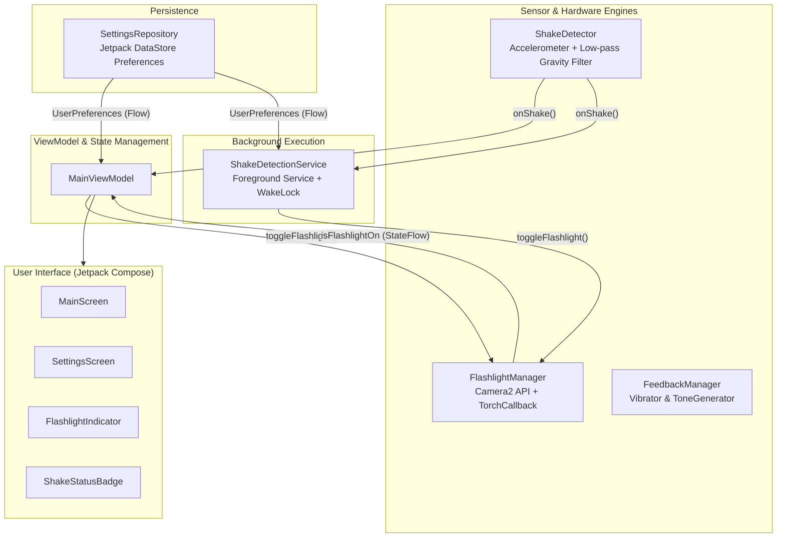

<div align="center">

# 🔦 ShakeTorch
### *Physical Gesture Flashlight Controller for Android*

[](https://kotlinlang.org/)
[](https://developer.android.com/jetpack/compose)
[-brightgreen?style=for-the-badge)](https://developer.android.com/)
[-blue?style=for-the-badge)](https://developer.android.com/)
[](https://developer.android.com/topic/architecture)
[](https://opensource.org/licenses/MIT)

<br/>

> **SHAKE YOUR PHONE = TOGGLE THE FLASHLIGHT**  
> *One intentional physical shake alternates between ON and OFF seamlessly.*

</div>

---

## 🌟 A Fun New Domain Project!

> [!NOTE]  
> **ShakeTorch** is a **fun new domain project** exploring the world of **mobile physical computing**, **hardware sensor fusion**, and **gesture-based interaction design**. Instead of traditional tap-to-click interfaces, this project dives into real-time accelerometer vector mathematics, gravity compensation filters, and low-latency hardware controls on modern Android devices.

Whether you're stepping into Android hardware APIs for the first time or exploring sensor-driven mobile UX, ShakeTorch demonstrates how to turn everyday smartphone physics into clean, intuitive, and tactile interactions!

---

## ⚡ The Core Interaction

The entire experience is anchored by a single golden rule:

<div align="center">

### **ONE SHAKE = ONE FLASHLIGHT STATE CHANGE**

| Current State | User Gesture | Result State |
| :---: | :---: | :---: |
| 🌑 **OFF** | 📱 *Shake Phone* | 💡 **ON** |
| 💡 **ON** | 📱 *Shake Phone* | 🌑 **OFF** |
| 🌑 **OFF** | 📱 *Shake Phone* | 💡 **ON** |
| 💡 **ON** | 📱 *Shake Phone* | 🌑 **OFF** |

*Alternates reliably and indefinitely.*

</div>

### Key Design Tenets:
- **Zero Confusion:** The exact same physical shake gesture turns the torch ON and OFF.
- **Single Trigger Guarantee:** One intentional shake yields exactly one state transition.
- **No Double-Shake Required:** Natural, single-motion gesture response.
- **Hardware-Synchronized:** If toggled manually in-app or via Android Quick Settings, the next shake toggles from the updated state.
- **Hands-Free Priority:** No button pressing required for day-to-day use.

---

## ✨ Features at a Glance

- 📱 **3D Euclidean Gesture Engine:** Orientation-invariant detection (works in portrait, landscape, upside-down, or flat).
- 🛡️ **Anti-Repeat Protection:** Combines a 1000 ms debounce cooldown with a hysteresis reset threshold to prevent accidental multi-toggling during continuous shaking.
- 🎚️ **Adjustable Sensitivity:**
  - **Low:** For active lifestyles (jogging, cycling) to avoid false positives.
  - **Medium:** Balanced default for natural everyday usage.
  - **High:** Effortless, feather-light flicks.
- 🎨 **Material Design 3 Glow UI:** Custom dark-mode aesthetic with pulsating amber halos and smooth state transitions.
- 📳 **Tactile & Audio Feedback:** Optional crisp haptic pulses and subtle acoustic clicks on each toggle.
- 🔔 **Background Foreground Service:** Run continuous shake detection even when the screen is dimmed or other apps are open (Android 14 `specialUse` compatible).
- 💾 **Persistent Settings:** Backed by Jetpack DataStore Preferences to survive app restarts and reboots.
- 🛡️ **Defensive Hardware Handling:** Graceful fallbacks for devices lacking flash hardware or accelerometer sensors.

---

## 📐 System Architecture

ShakeTorch adheres to Google's recommended **MVVM (Model-View-ViewModel)** and **Unidirectional Data Flow (UDF)** patterns:



---

## 🔬 How the Sensor Math Works

### 1. Gravity Isolation (High-Pass Filtering)
Smartphones are constantly subject to Earth's gravitational acceleration ($\approx 9.8\text{ m/s}^2$). To measure only the user's physical motion, a low-pass filter tracks the static gravity vector $\mathbf{g}$:

$$\mathbf{g}_t = \alpha \cdot \mathbf{g}_{t-1} + (1 - \alpha) \cdot \mathbf{a}_{\text{raw}} \quad (\alpha = 0.8)$$

Dynamic linear acceleration $\mathbf{a}_{\text{linear}}$ is then isolated:

$$\mathbf{a}_{\text{linear}} = \mathbf{a}_{\text{raw}} - \mathbf{g}_t$$

### 2. 3D Invariant Magnitude
The scalar acceleration magnitude is calculated using the 3D Euclidean norm:

$$|\mathbf{a}| = \sqrt{a_x^2 + a_y^2 + a_z^2}$$

Because this scalar magnitude is rotation-invariant, ShakeTorch responds equally well regardless of how the phone is held.

### 3. Hysteresis Anti-Repeat State Machine
1. **Trigger:** When $|\mathbf{a}| \ge \text{Threshold}$ and $\Delta t \ge \text{Cooldown}$, the shake event fires.
2. **Lockout:** Re-arming is blocked while $|\mathbf{a}|$ remains elevated during the remainder of the shake motion.
3. **Reset:** The detector will only re-arm once $|\mathbf{a}|$ drops below the $\text{Reset Threshold}$ ($\approx 3.5\text{ m/s}^2$) for at least $250\text{ ms}$.

---

## 📁 Repository File Layout

```text
ShakeTorch/
├── app/
│   ├── build.gradle.kts
│   ├── proguard-rules.pro
│   └── src/
│       ├── main/
│       │   ├── AndroidManifest.xml
│       │   ├── java/com/shaketorch/
│       │   │   ├── ShakeTorchApp.kt                  # Application class & notification channel
│       │   │   ├── MainActivity.kt                   # Single Activity host with runtime permissions
│       │   │   ├── data/
│       │   │   │   ├── SensitivityLevel.kt           # Low / Medium / High enum & thresholds
│       │   │   │   ├── UserPreferences.kt            # Immutable preferences data class
│       │   │   │   └── SettingsRepository.kt         # Jetpack DataStore implementation
│       │   │   ├── sensor/
│       │   │   │   ├── ShakeListener.kt              # Functional callback interface
│       │   │   │   └── ShakeDetector.kt              # 3D vector calculation & hysteresis logic
│       │   │   ├── flashlight/
│       │   │   │   ├── FlashlightState.kt            # Sealed statuses & error types
│       │   │   │   └── FlashlightManager.kt          # Camera2 API manager & TorchCallback sync
│       │   │   ├── service/
│       │   │   │   └── ShakeDetectionService.kt      # Foreground Service for background monitoring
│       │   │   ├── util/
│       │   │   │   └── FeedbackManager.kt            # Vibration & tone feedback
│       │   │   ├── viewmodel/
│       │   │   │   └── MainViewModel.kt              # MVVM orchestrator
│       │   │   └── ui/
│       │   │       ├── MainScreen.kt                 # Flashlight UI, status badge & manual button
│       │   │       ├── SettingsScreen.kt             # Sensitivity, cooldown & service toggles
│       │   │       ├── components/
│       │   │       │   ├── FlashlightIndicator.kt    # Pulsing glowing circular torch indicator
│       │   │       │   └── ShakeStatusBadge.kt       # Live detection status & trigger pill
│       │   │       └── theme/
│       │   │           ├── Color.kt                  # Dark obsidian & amber glow palette
│       │   │           ├── Theme.kt                  # Material 3 Theme setup
│       │   │           └── Type.kt                   # Typography definitions
│       │   └── res/
│       │       ├── drawable/                         # Vectors and notification icons
│       │       ├── mipmap-anydpi-v26/                # Adaptive app icons
│       │       ├── values/                           # Strings, colors, themes
│       │       └── xml/                              # Backup & extraction rules
│       └── test/
│           └── java/com/shaketorch/
│               ├── sensor/ShakeDetectorTest.kt       # Unit tests: debounce, thresholds, hysteresis
│               └── flashlight/FlashlightLogicTest.kt # Unit tests: toggle sequence & state sync
├── build.gradle.kts
├── settings.gradle.kts
├── gradle.properties
├── gradlew & gradlew.bat
└── README.md
```

---

## 🛠️ Tech Stack & Dependencies

- **Language:** Kotlin 1.9.23
- **Build System:** Gradle 8.4 with Android Gradle Plugin 8.3.2
- **Compile / Target SDK:** 34 (Android 14)
- **Min SDK:** 26 (Android 8.0 Oreo)
- **Jetpack Libraries:**
  - Compose BOM (`2024.04.01`) + Material 3
  - DataStore Preferences (`1.0.0`)
  - Lifecycle ViewModel Compose (`2.7.0`)
  - Core KTX (`1.13.1`) & Activity Compose (`1.8.2`)
- **Coroutines:** `kotlinx-coroutines-android:1.8.0`

---

## 🚀 Getting Started & Building

### Prerequisites
- [Android Studio Jellyfish or Hedgehog+](https://developer.android.com/studio)
- JDK 17 or higher
- Android SDK with API 34 installed

### 1. Clone the Repository
```bash
git clone https://github.com/your-username/ShakeTorch.git
cd ShakeTorch
```

### 2. Build Debug APK via Command Line

**On Windows (PowerShell):**
```powershell
.\gradlew.bat assembleDebug
```

**On Linux / macOS:**
```bash
chmod +x gradlew
./gradlew assembleDebug
```

The APK will be generated at:
```text
app/build/outputs/apk/debug/app-debug.apk
```

### 3. Install to Connected Device
```bash
adb install -r app/build/outputs/apk/debug/app-debug.apk
```

---

## 🧪 Running Unit Tests

The test suite validates gesture math, debounce timing, hysteresis reset conditions, and flashlight state synchronization:

```bash
# Windows
.\gradlew.bat test

# macOS / Linux
./gradlew test
```

---

## 📋 Comprehensive Testing Matrix

| Scenario | Action | Expected Behavior |
| :--- | :--- | :--- |
| **Shake when OFF** | Give phone one clear shake | Flashlight powers **ON**; UI glows amber; haptic pulse triggers. |
| **Shake when ON** | Give phone one clear shake | Flashlight powers **OFF**; UI darkens; haptic pulse triggers. |
| **Continuous shaking** | Shake phone rapidly back and forth 5 times | Flashlight toggles **once** on the first peak; hysteresis blocks repeated accidental toggles. |
| **Cooldown verification** | Shake once, wait 1.2s, shake again | Toggles cleanly on both gestures. |
| **Manual Turn ON** | Tap "Manual Turn ON" button in UI | Flashlight turns **ON**; status updates immediately. |
| **Shake after Manual ON** | Shake phone after manual turn ON | Flashlight turns **OFF** (state stays 100% in sync). |
| **Disable shake detection** | Disable "Enable Shake Detection" in Settings | Shaking does nothing; badge displays "Shake Disabled". |
| **Adjust sensitivity** | Switch to Low or High sensitivity | Thresholds update in real-time without app restart. |
| **Reboot / Restart** | Close app completely and reopen | All settings preserved via Jetpack DataStore. |
| **Background monitoring** | Enable background service, lock phone or switch apps | Persistent notification appears; shaking toggles the torch. |

---

## 🤝 Contributing

Contributions, issues, and feature ideas are welcome!
1. Fork the Project
2. Create your Feature Branch (`git checkout -b feature/AmazingFeature`)
3. Commit your Changes (`git commit -m 'Add some AmazingFeature'`)
4. Push to the Branch (`git push origin feature/AmazingFeature`)
5. Open a Pull Request

---

## 📄 License

Distributed under the **MIT License**. See `LICENSE` for more information.
